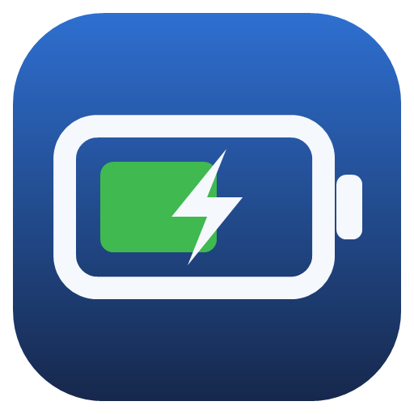

<p align="center">
  
</p>

<h1 align="center">BatTray</h1>
<p align="center"><b>Your devices. One glance.</b></p>
<p align="center">
  por <a href="https://github.com/koratsolutions-code"></a>
</p>

<p align="center">🌐 <a href="README.md">English</a> · <b>Español</b></p>

BatTray muestra el nivel de batería de tus periféricos (ratón, teclado, auriculares, mandos…) directamente
en la barra de tareas de Windows: el icono del dispositivo junto a su porcentaje.

```
[🖱 50%]  [🎧 80%⚡]  [⌨ 12%]   ⌃  🔊  🔋97%   13:45
```

## Funciones
- **Widget en la barra de tareas** con el icono y el porcentaje de cada dispositivo (verde / ámbar / rojo),
  en la barra de cada monitor. Si no hay sitio, se ocultan primero los que tienen más batería; nunca tapa
  los botones de las apps.
- **Panel de detalle** (clic izquierdo en el widget o en el icono de la bandeja): todos los dispositivos con
  barra de nivel, estado de carga, última lectura y origen.
- **Alertas de batería baja**: una notificación de Windows por descarga cuando un dispositivo llega al nivel crítico.
- **Icono y menú en la bandeja** (clic derecho): elegir qué dispositivos mostrar, iniciar con Windows,
  activar/desactivar alertas, informe de diagnóstico, carpeta de logs.
- Temas claro y oscuro, cualquier escalado DPI, barra que se oculta sola, apps a pantalla completa y reinicios del Explorador.

## Instalación
Descarga y ejecuta `BatTray-Setup-<versión>.msi`. Se instala **por usuario** (sin permisos de administrador)
en `%LocalAppData%\Programs\BatTray`, crea un acceso en el menú Inicio y arranca BatTray. Se desinstala desde
*Configuración › Aplicaciones*; el desinstalador también quita el inicio con Windows.

## Dispositivos soportados
| Fuente | Dispositivos | Cómo |
|---|---|---|
| Bluetooth LE | Ratones, teclados, auriculares y mandos modernos | Servicio GATT de batería (0x180F) |
| Bluetooth (Windows) | Auriculares clásicos y cualquier dispositivo que Windows reporte | Propiedad PnP `DEVPKEY_Bluetooth_Battery`, el valor de Configuración |
| Mandos de juego | Mandos Xbox (USB, adaptador inalámbrico Xbox, Bluetooth) y otros que Windows reporte | Informe de batería de `Windows.Gaming.Input` |
| Mandos PlayStation | DualShock 4, DualSense, DualSense Edge (USB y Bluetooth) | Campo de batería del report de entrada normal |
| Receptores USB (2,4 GHz) | Ver abajo | Protocolos HID enchufables |

### Receptores de 2,4 GHz
A diferencia de Bluetooth, los dongles de 2,4 GHz no tienen un estándar común de batería: cada fabricante usa
su propio protocolo. BatTray usa un catálogo de **protocolos enchufables** (`IHidBatteryProtocol`):

| Protocolo | Dispositivos |
|---|---|
| Logitech HID++ 2.0 (0x1004, 0x1000, 0x1001) | Receptores Unifying, Bolt, Lightspeed (hasta 6 dispositivos cada uno) y Logitech por USB |
| Razer (feature report de 90 bytes) | Ratones y teclados inalámbricos (receptor y cable) |
| SteelSeries | Arctis 1/7/7+/Pro/7X/7P, Arctis Nova 3P/5/7, Aerox 3/5/9, Prime, Rival 3 Wireless, Rival 650 |
| Corsair | Auriculares Void/HS antiguos y dispositivos Bragi (Dark Core, Ironclaw, Harpoon, M65/M75, K57/K70, Slipstream, Virtuoso, HS80…) |
| HyperX | Cloud Flight, Cloud Alpha Wireless, Cloud II Wireless, Cloud Alpha 2, Pulsefire Haste 2 |
| Sino Wealth "Aurora" | Glorious Model O Wireless, Lamzu, Attack Shark R5 Ultra |
| MonsGeek / Akko (RongYuan) | Teclados MonsGeek y Akko con su dongle de 2,4 GHz (3151:5037/5038) |
| Keychron Ultra-Link | Ratones Keychron M2 / M5 / M6 |
| Rapoo | Receptor Rapoo VT3 PRO |
| Ajazz | Ajazz AJ179 |
| Darmoshark | Ratones Darmoshark (receptor 1915:0723) |
| MCHOSE (Realtek) | MCHOSE L7 / M7 / A7 V2 / K7 |
| GetPower (Compx/Areson/Nordic) | Redragon (25A7:FA07/FA08), ATK, VXE, VGN, Dareu, Zaopin, Scyrox, G-Wolves |
| Batería HID estándar (0x06/0x20, 0x85) | Cualquier receptor que siga la especificación HID |

**Seguridad:** solo se envían consultas de lectura, y solo a receptores que un protocolo reconoce con certeza.
Nunca se usan comandos que cambien ajustes o el modo del dongle. A los receptores no reconocidos nunca se les
escribe nada; usa **Save diagnostics report…** para registrar su estructura
HID y poder añadirlos.

> Los protocolos de Razer, SteelSeries, Corsair, HyperX, PlayStation, Aurora, MonsGeek/Akko, Keychron, Rapoo,
> Ajazz, Darmoshark y MCHOSE están implementados a partir de
> documentación pública y drivers de código abierto y cubiertos con tests, pero aún no se han verificado con hardware real.

## Ajustes
Todo se configura desde el menú de la bandeja (clic derecho en el icono de BatTray o en el widget):
- **Cada dispositivo** aparece con su nivel: desmárcalo para ocultarlo de la barra.
- **Start with Windows**: iniciar con Windows.
- **Low battery alerts**: activar o desactivar las alertas.
- **Save diagnostics report…** y **Open log folder**: útiles para pedir soporte.
- **About BatTray**: versión, web y licencia.

El nivel se pone ámbar por debajo del 30% y rojo por debajo del 15%, que es cuando salta la alerta.

## Licencia
[MIT](LICENSE) © 2026 Korat Solutions.
