<picture>
  <source media="(prefers-color-scheme: dark)" srcset="docs/images/header-dark.png" />
  
</picture>

🌐 **English** · [Español](README.es.md)

BatTray shows the battery level of your wireless peripherals (mouse, keyboard, headset, earbuds, gamepad…) right on
the Windows taskbar: the device icon next to its percentage.

**Bluetooth and 2.4 GHz, in one place.** Windows only shows the battery of some Bluetooth devices, and 2.4 GHz
USB receivers (dongles) have no common battery standard: every brand uses its own protocol, usually only readable
by its own app. BatTray reads both: Bluetooth devices, and 2.4 GHz receivers from more than 70 protocols and brands,
with no vendor software needed.

<picture>
  <source media="(prefers-color-scheme: dark)" srcset="docs/images/showcase-dark.png" />
  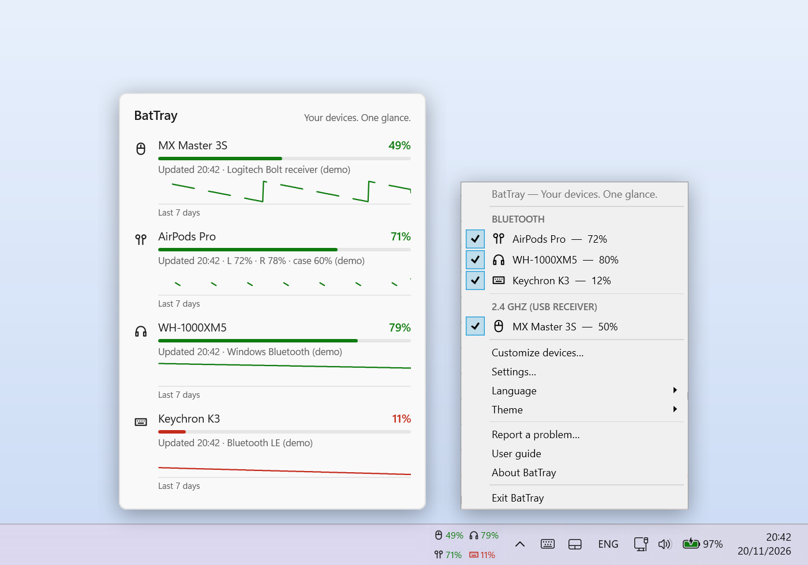
</picture>

<b>See it in action</b> (widget, panel, menu and settings, light and dark)

## Features
- **Taskbar widget** with each device's icon and percentage (green / amber / red), on every monitor's taskbar.
  When there is no room, the devices with the most battery are hidden first — app buttons are never covered. 
  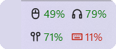
- **Detail panel** (left-click the widget or the tray icon, or press **Ctrl+Alt+B**): every device with a level
  bar, charging state, last reading, source and a **7-day battery chart**. 
  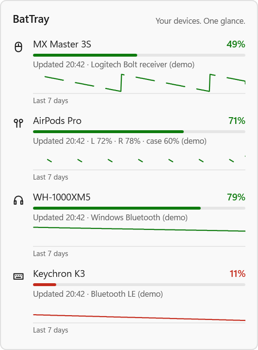
- **Low battery alerts**: one Windows notification per discharge when a device drops to the critical level, or
  to its own level (each device can have a different one, or none). 
  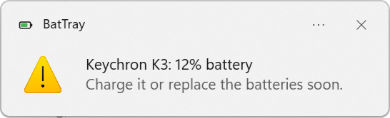
- **Full charge notice**: tells you when a device reaches 100 % so you can unplug it. 
  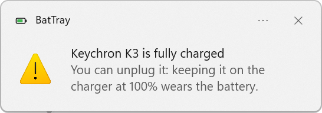
- **Your layout**: choose the order of the devices, show the percentage always, only when it is low, or never
  (icons only), and pick small, normal or large items. 
  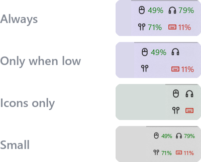
- **Usage-based estimates** for devices that never report their battery (many budget headsets and mice):
  BatTray counts how long you use them and shows an estimate such as `~62%`. 
  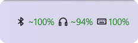
- **Tray icon and menu** (right-click), grouped into **Bluetooth**, **2.4 GHz (USB receiver)** and **Controllers**. 
  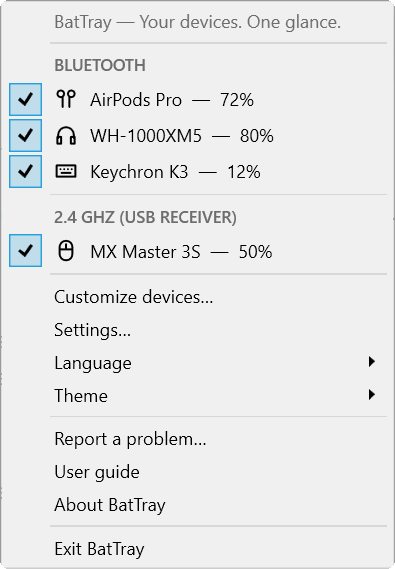
- **English and Spanish**: follows the Windows language, or pick one in Settings. 
  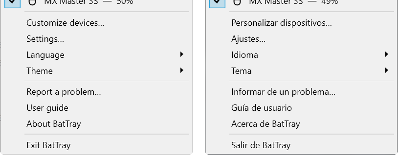
- **Light and dark theme** for menus and windows (follows Windows or your choice); any DPI scaling, auto-hide
  taskbar, full-screen apps, Explorer restarts. 
  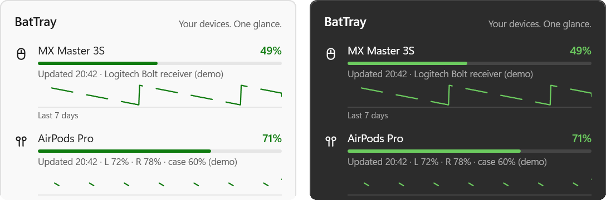
- **One-click updates**: when a new version is published (optional check), BatTray downloads the installer
  from GitHub, verifies it and installs it. **Report a problem** in one click. 
  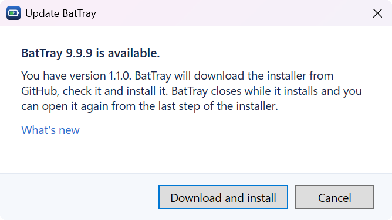

## Install
**[Download the latest installer](https://github.com/koratsolutions-code/BatTray/releases/latest)** and run
`BatTray-Setup-<version>.msi`. It installs **per user** (no administrator rights) to
`%LocalAppData%\Programs\BatTray`, adds a Start menu entry and starts BatTray. Uninstall it from
*Settings › Apps*; the uninstaller also removes the start-with-Windows entry.

The installer includes a **user guide** (Start menu → *BatTray User Guide*, or *User guide* in BatTray's menu).
If Windows shows *"Windows protected your PC"*, click **More info → Run anyway**: the installer is not code-signed yet.

## Supported devices
More than 70 protocols covering hundreds of models. Most of the 2.4 GHz protocols are implemented from public protocol
documentation and have not been confirmed by a BatTray user yet: if yours works (or not), please report it.

| Source | Devices |
|---|---|
| Bluetooth LE | Modern mice, keyboards, headsets and controllers (GATT Battery Service) |
| Bluetooth (Windows) | Classic headsets and any device whose battery Windows shows in Settings |
| Earbuds | **Apple AirPods / Beats** and **Google Fast Pair** earbuds (Pixel Buds, Jabra Elite, many Sony / JBL / Bose) read from their Bluetooth broadcasts; **Samsung Galaxy Buds** and **Nothing / CMF** over their Bluetooth service — left, right and case |
| Game controllers | Xbox (USB, adapter, Bluetooth), DualShock 4, DualSense / Edge, Switch Pro and compatible pads, 8BitDo (Ultimate, Pro 2/3, SN30/SF30 Pro), GameSir (Nova, Cyclone 2, Cyclone Pro over Bluetooth), Flydigi (Vader 5 Pro, Apex 5), Steam Controller, BEITONG |
| HeadsetControl | Every headset supported by [HeadsetControl](https://github.com/Sapd/HeadsetControl), if you install it yourself (next to BatTray.exe or in `%LocalAppData%\Programs\HeadsetControl`) |
| USB receivers (2.4 GHz) | See below |

### 2.4 GHz receivers and USB devices
Unlike Bluetooth, 2.4 GHz dongles have no common battery standard: every vendor uses its own protocol.

| Category | Brands and models |
|---|---|
| Major brands | **Logitech** (Unifying, Bolt, Lightspeed, G headsets, older HID++ 1.0 devices), **Razer** (wireless mice and keyboards; BlackShark V2 HyperSpeed / V2 Pro / V3 X), **SteelSeries** (Arctis 1/7/9/Pro/Nova 3P/5/7/Pro/Elite, Aerox, Prime, Rival), **Corsair** (Void/HS, Bragi devices, Sabre V2 Pro), **HyperX** (Cloud Flight / Flight S / Alpha / II / II Core / III / III S / Stinger Core, Pulsefire Haste 2 / Mini), **ASTRO** A50 / A20, **Audeze** Maxwell, **Sony INZONE** H9 II / H5 / Buds, **Keychron** (Ultra-Link, 1K and 4K receivers, Nape Pro) |
| Gaming mice | Glorious, Hitscan, G-Wolves, WLMouse, LAMZU, Arbiter, Pulsar (X2 V3, XS-1), ATK / VXE (incl. Nano dongles), VGN, Scyrox, Endgame Gear, Ninjutso, Sprime, ZOWIE, VAXEE, Finalmouse, ROG, MSI, Cooler Master, Fantech, Machenike, Incott, EWEADN, Niceboy, Redragon, HECATE, Zenith, Chimera, Darmoshark, Rapoo VT, Ajazz AJ179 / AJ139, Delux, Motospeed, Attack Shark, Inphic, ARDOR Fury V2, Taidu, Zaopin, Dareu, Sharkoon |
| Keyboards | MonsGeek, Akko, RongYuan-based keyboards (Attack Shark, AJAZZ, MSI…), AULA, MCHOSE, Royal Kludge, CHERRY, NuPhy, EPOMAKER, URX / EVO80 (VIA), Semico-based keyboards, Redragon, ATK / VGN / VXE |
| Headsets | Razer, ASTRO, SteelSeries, HyperX, Corsair, Audeze, Sony INZONE, JBL Quantum, Jabra, AKG N9 Hybrid, ENDORFY Viro, NZXT Lift, Fractal Scape, MOONDROP GM01, MAONO PD200W, DARKRIM, MCHOSE, ATK, VGN, Alienware AW920H |
| Any other | Receivers that follow the HID battery specification |

Not supported (they need commands that are not read-only, so BatTray does not send them): Logitech G435, Razer
BlackShark V2 Pro 2023 / V3 / Barracuda, Turtle Beach Stealth 700 Gen 3, Poly BT600, RAWM, PMO / WOBKEY keyboards.

### Confirmed by users
Devices that people have checked with BatTray. **Does yours work?** [Tell us](https://github.com/koratsolutions-code/BatTray/issues/new?template=device-works.yml)
and it will be added here, with your name if you like. **Doesn't it?**
[Send a diagnostics report](https://github.com/koratsolutions-code/BatTray/issues/new?template=device-not-working.yml) and we will try to add it.

**No GitHub account?** Email [koratsolutions@gmail.com](mailto:koratsolutions@gmail.com?subject=BatTray%20device) with the
device's brand and model, what BatTray shows, and the diagnostics report (right-click BatTray → **Report a problem…**,
or *Settings → Save diagnostics report…*). The same works to tell us that your device works.

| Device | Connection | Battery | Confirmed by | Version |
|---|---|---|---|---|
| Ozeino OW810 headset | Bluetooth | ✅ Read (Windows Bluetooth) | Korat Solutions | 1.0 |
| Ozeino OW810 headset | 2.4 GHz dongle (`3206:0861`) | 〰️ Estimated from usage — the dongle sends no battery data | Korat Solutions | 1.0 |
| Klip Xtreme Orbix KMW500 mouse | 2.4 GHz receiver (`3151:1025`) | ✍️ Level set manually — the receiver sends no battery data | Korat Solutions | 1.0 |

✅ read from the device · 〰️ estimated from usage · ✍️ set manually · ❌ not supported

**Safety:** only read-only queries are sent, and only to receivers a protocol positively recognises.
Commands that change settings or switch dongle modes are never used. Unrecognised receivers are never
written to — use **Report a problem…** (or *Settings → Save diagnostics report…*) to capture their HID layout so
support can be added.

**Privacy:** BatTray only connects to GitHub: for the optional daily update check (an anonymous request for the
latest version number; turn it off in Settings) and, when you choose to install an update, to download it. Nothing
about you or your devices is sent. The battery history stays on your PC.

> The Razer, SteelSeries, Corsair, HyperX, PlayStation, Aurora, MonsGeek/Akko, Keychron, Rapoo, Ajazz,
> Darmoshark and MCHOSE protocols are implemented from public
> documentation and open-source drivers and covered by unit tests, but not yet verified on real hardware.

## Menu
Right-click the widget or the BatTray icon in the notification area. Devices are grouped by connection:
**Bluetooth**, **2.4 GHz (USB receiver)** and **Controllers**.
- **Each device** is listed with its level: untick it to hide it from the taskbar.
- **USB receivers that send no battery data** are listed under *2.4 GHz* with a submenu (see below), or
  **Hide this receiver** — for example a dongle whose keyboard you use over Bluetooth. Hidden receivers can be
  shown again from *Hidden receivers*. Built-in, wired devices (like a laptop keyboard) are never listed.
- **Customize devices…**: rename any device and pick its icon from the built-in set (mouse, keyboard, headset,
  earbuds, speaker, microphone, gamepad, trackball, pen, phone, tablet, watch, battery, Bluetooth) or upload your
  own image (PNG, JPG, BMP, GIF or ICO; it is resized to 64×64 and stored in BatTray's settings folder).
  Drag the devices (or use the arrows) to set their **order on the taskbar**, and choose each device's
  **low battery notification**: the general level, its own level, or never.
- **Update available** (when there is one): opens a window that downloads the new installer from this project's
  GitHub releases, checks that its size and SHA-256 match what GitHub published, and installs it.
- **Settings…**: see below.
- **Report a problem…**: saves a diagnostics report, shows it in File Explorer and opens a pre-filled GitHub issue.
- **User guide** and **About BatTray**.

## Settings
Three tabs; changes apply at once.

| Tab | Setting | Default |
|---|---|---|
| Battery | Low level (amber) / critical level (red) | below 30 % / below 15 % |
| Battery | Notify me when a device reaches the critical level | on |
| Battery | Notify me when a device finishes charging | on |
| Battery | Keep a 7-day battery history and show it as a chart (turning it off deletes it) | on |
| Taskbar | Percentage next to each icon: always / only below a level / never (icons only) | always |
| Taskbar | Size: small / normal / large | normal |
| Taskbar | Order, rename and change icons… (opens Customize devices) | — |
| Taskbar | Show on the taskbar of every monitor | on |
| General | Language | same as Windows (English or Spanish) |
| General | Menus and windows (theme) | same as Windows (light or dark) |
| General | Start with Windows | on after installing |
| General | Open the panel with a keyboard shortcut (click the box and press new keys to change it) | on, Ctrl+Alt+B |
| General | Check for new versions once a day | on |

Settings are stored in `%AppData%\KoratSolutions\BatTray\settings.json` and the history in `history.json` in the
same folder; logs in `%LocalAppData%\KoratSolutions\BatTray\logs`.

### Devices without battery data
Some devices do not send their battery level to the PC at all, so nothing can read it. Their receivers appear
in the menu under **2.4 GHz** marked *no battery data*, with two options:

- **Set level manually**: pick 100 / 75 / 50 / 25 % or *Other…*. The level stays fixed until you change it.
- **Estimate from usage**: enter the battery life (hours of use on a full charge, from the manual) and the
  current charge. From then on:
  - A headset counts as in use while sound plays through it, and for 10 minutes after.
  - A mouse or keyboard counts as in use while you use it, and for 10 minutes after.

Both are shown with a `~` (for example `~62%`). Each device's submenu has **Set current level**,
**I just charged it**, a switch between the two modes and **Remove**.

An estimate is an approximation: the real battery depends on volume, lighting and the battery's age.
Estimates are stored in `%AppData%\KoratSolutions\BatTray\estimates.json`.

## License
[MIT](LICENSE) © 2026 Korat Solutions.
